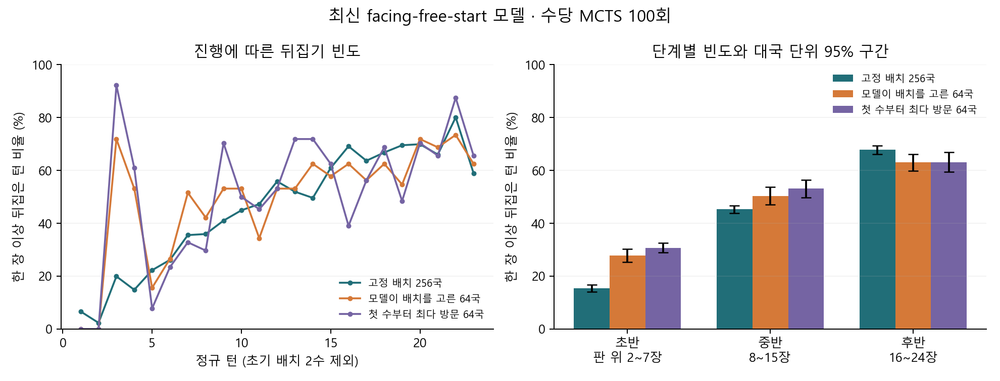

# 최신 모델의 뒤집기 양상 — 2026-10-29

**모델이 직접 배치를 고른 64국에서는 뒤집기가 초반 27.9%, 중반 50.4%, 후반 63.1%의 턴에서 발생했다.** 3장 이상 포획 97회 중 76회가 후반에 집중됐다.

뒤집기는 상대 타일의 소유 색이 바뀌는 포획을 뜻한다. 초기 배치 두 수를 제외하고, 패스를 포함한 정규 턴을 분모로 쓴다. 같은 타일을 나중에 다시 뒤집으면 장수에 다시 센다.

모델: `8206189b7076859296da55587984cc5fb750e2b30fddf6140650f38b43421a05`. 최신 `temp/best.pth.tar`의 고정 사본을 사용했다.
10월 26일 보고서의 모델 `28bf57af…`와는 다르므로 이전 수치를 최신 결과로 재사용하지 않았다.

가중치와 일치하는 학습 후보: `candidate_0884e6c22c01_1.pth.tar`, 채택=True.

## 표본과 전체 빈도

| 대국 방식 | 대국 수 | 포획 턴 / 전체 턴 | 뒤집기 빈도 | 한 판 평균 포획 턴 | 한 판 평균 뒤집은 장수 |
|---|---:|---:|---:|---:|---:|
| 고정 8배치 | 256 | 2794 / 5991 | 46.6% | 10.91회 | 17.07장 |
| 모델이 선택한 배치 | 64 | 734 / 1481 | 49.6% | 11.47회 | 18.36장 |
| 모델 선택 배치·첫 수부터 최다 방문 | 64 | 768 / 1496 | 51.3% | 12.00회 | 17.23장 |

고정 배치는 3·8·11·18·19·130·133·167번을 각 32국, 회전·반사 8방향을 각 4국 사용했다. 기존 비교 배치, 예비 상위 후보, 먼 배치 일부를 사전에 골랐으며 전체 168개 배치의 무작위 표본은 아니다. 모델 선택 배치 64국은 빈 판에서 양쪽이 MCTS 방문 분포에 따라 초기 두 타일을 선택했다. 집단별 배치 분포와 선택 과정이 달라 합산하지 않았다.

모든 대국은 양쪽에 같은 최신 모델, 정규 수당 MCTS 100회, cpuct=1.5, 루트 노이즈 없음이다. 기본 두 집단은 초기 배치 이후 첫 6수는 방문 비율로 추첨하고 이후 최다 방문 수를 선택했다. 고정 배치 seed=2026102901, 모델 선택 배치 seed=2026102902. 선택된 배치는 모델 정책 전체의 균등 표본이나 인간 대국의 표본이 아니다.

## 언제 많이 발생하는가

단계는 **수를 두기 직전 판 위의 타일 수**로 구분했다. 패스가 있으면 정규 턴 번호와 다를 수 있다.

| 방식 | 단계 | 포획 턴 / 전체 턴 | 빈도 | 대국 단위 근사 95% 구간 | 턴당 뒤집은 장수 | 3장 이상 뒤집은 턴 |
|---|---|---:|---:|---:|---:|---:|
| 고정 8배치 | 초반: 판 위 2~7장 | 236 / 1536 | 15.4% | 14.1%~16.7% | 0.18장 | 3회 |
| 고정 8배치 | 중반: 8~15장 | 927 / 2048 | 45.3% | 43.8%~46.7% | 0.62장 | 68회 |
| 고정 8배치 | 후반: 16~24장 | 1631 / 2407 | 67.8% | 66.2%~69.4% | 1.17장 | 283회 |
| 모델이 선택한 배치 | 초반: 판 위 2~7장 | 107 / 384 | 27.9% | 25.3%~30.2% | 0.29장 | 2회 |
| 모델이 선택한 배치 | 중반: 8~15장 | 258 / 512 | 50.4% | 47.1%~53.7% | 0.68장 | 19회 |
| 모델이 선택한 배치 | 후반: 16~24장 | 369 / 585 | 63.1% | 59.9%~66.2% | 1.23장 | 76회 |
| 모델 선택 배치·첫 수부터 최다 방문 | 초반: 판 위 2~7장 | 118 / 384 | 30.7% | 28.9%~32.6% | 0.31장 | 0회 |
| 모델 선택 배치·첫 수부터 최다 방문 | 중반: 8~15장 | 272 / 512 | 53.1% | 49.8%~56.5% | 0.67장 | 9회 |
| 모델 선택 배치·첫 수부터 최다 방문 | 후반: 16~24장 | 378 / 600 | 63.0% | 59.5%~66.8% | 1.07장 | 82회 |

기본 방식은 초반 6수에 확률 선택을 쓰므로 초·후반 차이에 보드 상태와 선택 방식 변화가 함께 반영된다. 별도 대조군은 초기 배치를 동일하게 확률 선택하되 정규 첫 수부터 최다 방문 수를 선택했다. 95% 구간은 한 대국의 턴을 함께 재표집한 근사 구간이다. 고정 배치는 배치·방향 안에서, 모델 선택 배치는 대국 전체를 재표집했다(5,000회, seed=2026102942). 턴을 서로 독립 표본으로 간주하지 않았다.



## 초반의 예외: 정규 3수째 포획 피크

초·중·후반 평균과 별도로, 현재 모델이 선택한 배치에서는 정규 3수째에 짧고 강한 피크가 있었다. 초기 배치 두 수는 아래 턴 번호에서 제외했다.

| 방식 | 1수 | 2수 | 3수 | 4수 | 5수 | 6수 |
|---|---:|---:|---:|---:|---:|---:|
| 고정 8배치 | 6.6% | 2.3% | 19.9% | 14.8% | 22.3% | 26.2% |
| 모델이 선택한 배치 | 0.0% | 0.0% | 71.9% | 53.1% | 15.6% | 26.6% |
| 모델 선택 배치·첫 수부터 최다 방문 | 0.0% | 0.0% | 92.2% | 60.9% | 7.8% | 23.4% |

모델 선택 배치 64국에서는 138번 34국·139번 30국으로, 두 초기 타일이 행·열 각각 4칸 떨어진 5×5의 대각 모서리 배치만 선택됐다. 3수째 포획은 기본 방식 46/64국(71.9%), 첫 수부터 최다 방문 방식 59/64국(92.2%)에서 발생했고 모두 1장 포획이었다. 이때 첫 정규 수에 둔 내 타일을 종착점으로 삼아 초기 상대 타일을 L자 경로로 뒤집을 수 있다. 이 피크는 현재 모델이 고른 배치와 수순에 조건부이며 고정 8배치 전체에서는 3수째 19.9%였다.

## 상대가 먹은 직후와 재포획

| 방식 | 상대가 직전 턴에 먹었을 때 내 포획 | 직전 턴에 먹지 않았을 때 내 포획 | 직전 포획 타일을 즉시 되찾은 턴 / 응수 기회 | 전체 포획 중 과거에 이미 뒤집혔던 타일 |
|---|---:|---:|---:|---:|
| 고정 8배치 | 56.3% (1451/2579) | 39.4% (1343/3412) | 113/2579 (4.4%) | 970/4369 (22.2%) |
| 모델이 선택한 배치 | 53.6% (372/694) | 46.0% (362/787) | 46/694 (6.6%) | 262/1175 (22.3%) |
| 모델 선택 배치·첫 수부터 최다 방문 | 57.5% (412/716) | 45.6% (356/780) | 41/716 (5.7%) | 217/1103 (19.7%) |

첫 수는 직전 포획 없음에 포함했다. 즉시 재포획은 바로 전 상대 턴에 뒤집힌 동일 타일을 되찾은 경우다. 재포획 타일은 판의 재중앙정렬 전후에 동일한 ID를 추적했다. 포획 응수와 동일 타일 되찾기는 다른 사건이다. 이 조건부 비율은 진행 단계 등도 함께 달라지므로 인과효과로 해석하지 않는다.

| 방식 | 단계 | 직전 포획 있음: 내 포획 빈도 | 직전 포획 없음: 내 포획 빈도 |
|---|---|---:|---:|
| 고정 8배치 | 초반: 판 위 2~7장 | 14.2% (169턴) | 15.5% (1367턴) |
| 고정 8배치 | 중반: 8~15장 | 45.3% (867턴) | 45.2% (1181턴) |
| 고정 8배치 | 후반: 16~24장 | 67.0% (1543턴) | 69.1% (864턴) |
| 모델이 선택한 배치 | 초반: 판 위 2~7장 | 35.6% (90턴) | 25.5% (294턴) |
| 모델이 선택한 배치 | 중반: 8~15장 | 46.8% (235턴) | 53.4% (277턴) |
| 모델이 선택한 배치 | 후반: 16~24장 | 62.3% (369턴) | 64.4% (216턴) |
| 모델 선택 배치·첫 수부터 최다 방문 | 초반: 판 위 2~7장 | 38.8% (103턴) | 27.8% (281턴) |
| 모델 선택 배치·첫 수부터 최다 방문 | 중반: 8~15장 | 53.9% (241턴) | 52.4% (271턴) |
| 모델 선택 배치·첫 수부터 최다 방문 | 후반: 16~24장 | 65.1% (372턴) | 59.6% (228턴) |

## 포획 경로와 놓는 자리

facing 규칙에서는 새 타일이 방금 돌린 상대 타일을 바라본다. 그 타일부터 화살표를 따라 상대 타일들이 이어지고 마지막에 기존 내 타일에 닿아야 뒤집힌다. 중간에 빈칸으로 나가거나, 새 타일로 되돌아오거나, 상대 타일끼리 순환하면 실패한다. 따라서 직선 샌드위치뿐 아니라 방향이 꺾이는 경로도 가능하다.

| 방식 | 1장 / 2장 / 3장 이상 포획 턴 | 꺾이는 경로 / 전체 포획 경로 | 한 턴 최대 뒤집기 | 포획 가능한 수가 있던 턴 | 그때 실제 포획 선택 |
|---|---:|---:|---:|---:|---:|
| 고정 8배치 | 1915 / 525 / 354회 | 1906/2794 (68.2%) | 10장 | 87.5% | 53.3% |
| 모델이 선택한 배치 | 528 / 109 / 97회 | 619/734 (84.3%) | 12장 | 85.6% | 57.9% |
| 모델 선택 배치·첫 수부터 최다 방문 | 594 / 83 / 91회 | 662/768 (86.2%) | 7장 | 85.1% | 60.3% |

경로가 꺾였다는 것은 새 타일에서 기존 내 타일까지의 이동 방향이 둘 이상이었다는 뜻이다. 1장 포획도 L자로 꺾일 수 있다. 포획 가능 여부는 실제 수 직전의 모든 합법 수를 검사했다. 가능한데 선택하지 않은 비율만으로 모델의 실수나 의도를 판단할 수는 없다.

| 방식 | 놓을 칸에 인접한 기존 타일 수 | 포획 턴 / 해당 자리 선택 턴 | 빈도 |
|---|---:|---:|---:|
| 고정 8배치 | 1 | 842/2506 | 33.6% |
| 고정 8배치 | 2 | 1430/2604 | 54.9% |
| 고정 8배치 | 3 | 443/682 | 65.0% |
| 고정 8배치 | 4 | 79/96 | 82.3% |
| 모델이 선택한 배치 | 1 | 261/674 | 38.7% |
| 모델이 선택한 배치 | 2 | 324/546 | 59.3% |
| 모델이 선택한 배치 | 3 | 124/214 | 57.9% |
| 모델이 선택한 배치 | 4 | 25/38 | 65.8% |
| 모델 선택 배치·첫 수부터 최다 방문 | 1 | 248/686 | 36.2% |
| 모델 선택 배치·첫 수부터 최다 방문 | 2 | 362/542 | 66.8% |
| 모델 선택 배치·첫 수부터 최다 방문 | 3 | 115/186 | 61.8% |
| 모델 선택 배치·첫 수부터 최다 방문 | 4 | 43/58 | 74.1% |

놓을 칸의 상하좌우를 수 직전에 검사했다. 인접 타일이 많다는 조건은 진행 단계·모델의 자리 선택과 얽혀 있다. 위 빈도는 관측된 선택에서의 상관관계다.

## 초기 배치별 차이

| 배치 ID | 대국 수 | 뒤집기 턴 비율 | 한 판 평균 뒤집은 장수 |
|---:|---:|---:|---:|
| 18 | 32 | 50.1% | 16.53장 |
| 19 | 32 | 48.2% | 16.06장 |
| 11 | 32 | 47.9% | 16.12장 |
| 167 | 32 | 46.4% | 17.94장 |
| 133 | 32 | 46.1% | 17.03장 |
| 8 | 32 | 45.7% | 17.31장 |
| 3 | 32 | 44.6% | 18.16장 |
| 130 | 32 | 44.0% | 17.38장 |

32국씩의 표본 순위로 배치의 장기 우열이나 전체 168개 중 최고를 확정하지 않는다. 이전 10월 26일 순위와 같은 조건의 모델 대조 실험을 한 것은 아니다.

모델이 직접 선택한 초기 배치: 138번 34국, 139번 30국.

## 후반의 실제 사례

모델 선택 배치 대국 38번은 정규 23수째, 판 위 24장 상태에서 한 번에 12장을 뒤집었다. 초록 기준 타일 수 차이가 -4에서 +21로 바뀌었다. 이것은 해당 64국 중 한 번 관측된 최대 사례로 평균적인 포획 크기를 뜻하지 않는다.

## 검증과 재현

모든 수의 합법성, 엔진 포획 경로와 별도 경로 추적의 일치, 소유 타일 수 변화, 재중앙정렬 후 보드, 최종 승패·점수 차이를 검사했다. 추가로 이전 고정 모델 대국 128국·3,001턴을 기존 분석기와 교차검증해 포획 수열과 최장 연속 포획 길이가 모두 일치했다.

- `model_metadata.json`: 원본 및 학습 후보와 모델 해시.
- `fixed.json`, `free.json`, `greedy.json`: 전체 수순·보드·결과와 탐색 설정.
- `patterns.json`: 집단별·단계별 집계와 근사 구간.
- `turns.json`: 턴별 포획, 타일 재포획, 인접도 및 합법 포획 기회.
- `validation.json`: 기존 분석기와의 교차검증 기록.
- `control_validation.json`: 기본 방식과 대조군의 초기 보드 64쌍이 동일함을 검증.
- `patterns.png`, `patterns.svg`: 내보내기 가능한 도표.

```powershell
python ../select_facing_openings.py --output evaluations/flip-patterns-20261029 --model temp/best.pth.tar --label fixed --ids 3 8 11 18 19 130 133 167 --games 32 --sims 100 --seed 2026102901 --batch-size 32
python analyze_flip_patterns.py --folder evaluations/flip-patterns-20261029 --play-free 64
python analyze_flip_patterns.py --folder evaluations/flip-patterns-20261029 --play-free 64 --label greedy --random-regular-plies 0
python analyze_flip_patterns.py --folder evaluations/flip-patterns-20261029
```
